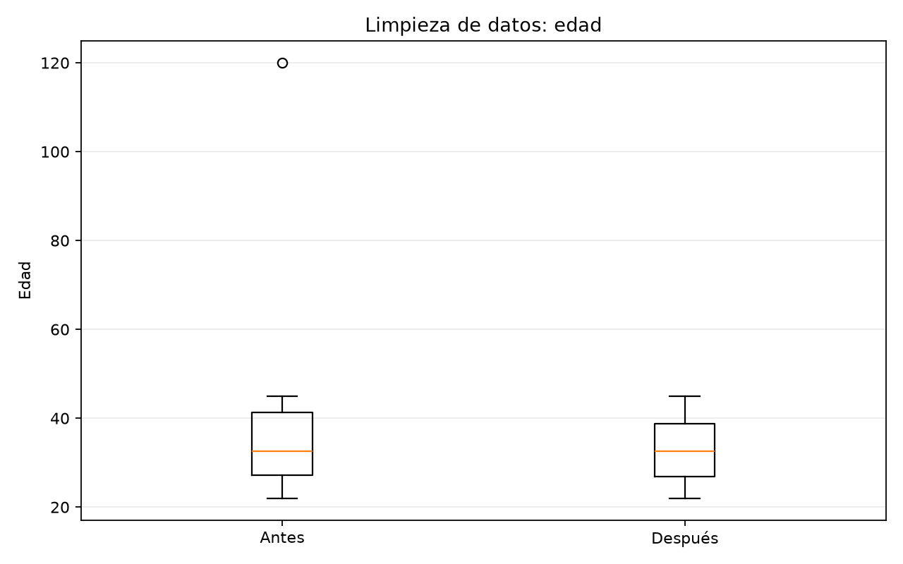
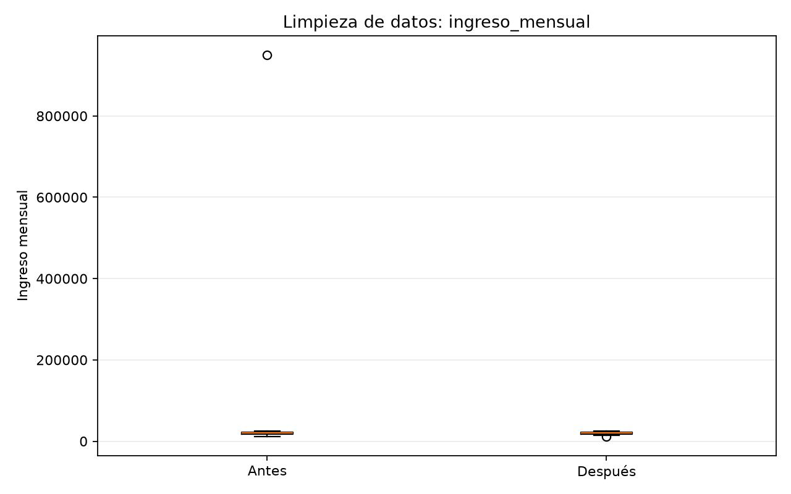

# Práctica 3: Limpieza de Datos Avanzada en Python

Implementación de un proceso de preparación y limpieza de datos utilizando **Python**, el método del **rango intercuartílico (IQR)** y el algoritmo **K-Nearest Neighbors (KNN)** para detectar valores atípicos y estimar valores faltantes.

## 1. Objetivo

Desarrollar un proceso de limpieza de datos que permita:

- Identificar valores faltantes en un conjunto de datos.
- Detectar valores atípicos mediante el método IQR.
- Sustituir temporalmente los valores atípicos por `NaN`.
- Aplicar imputación mediante `KNNImputer`.
- Comparar los resultados de KNN con los métodos de media y mediana.
- Evaluar diferentes valores de `k`.
- Generar gráficos comparativos antes y después de la limpieza.

## 2. Tecnologías utilizadas

| Tecnología | Función |
|---|---|
| Python | Lenguaje de programación |
| Pandas | Manipulación y análisis de datos |
| NumPy | Operaciones numéricas y valores `NaN` |
| Scikit-learn | Imputación KNN y estandarización |
| SciPy | Biblioteca científica incluida en el entorno |
| Matplotlib | Generación de gráficos |
| PyYAML | Lectura de la configuración |
| AWS EC2 | Entorno de ejecución Ubuntu |
| Git y GitHub | Control de versiones |

## 3. Estructura del proyecto

```text
practica3/
├── practica3.py
├── config.example.yaml
├── requirements.txt
├── README.md
├── .gitignore
└── graficos/
    ├── comparacion_edad.png
    └── comparacion_ingreso_mensual.png
```

El archivo `config.yaml` se genera localmente a partir de `config.example.yaml` y está excluido del repositorio mediante `.gitignore`.

## 4. Dataset utilizado

Se utiliza un conjunto de datos sintéticos compuesto por 10 registros y tres variables:

- `edad`: edad de la persona.
- `ingreso_mensual`: ingreso mensual registrado.
- `scoring_credito`: puntuación crediticia.

El dataset contiene cuatro valores faltantes originales y dos valores atípicos:

- Edad de `120` años.
- Ingreso mensual de `$950,000`.

Estos datos permiten demostrar las etapas de detección, tratamiento e imputación.

## 5. Metodología

### 5.1 Identificación de valores faltantes

Se utiliza `isna().sum()` para contar los valores ausentes en cada columna.

Resultado inicial:

| Variable | Valores faltantes |
|---|---:|
| edad | 2 |
| ingreso_mensual | 2 |
| scoring_credito | 0 |
| **Total** | **4** |

### 5.2 Detección de valores atípicos mediante IQR

El rango intercuartílico se calcula mediante:

**IQR = Q3 - Q1**

Los límites de detección son:

- Límite inferior = Q1 - 1.5 × IQR
- Límite superior = Q3 + 1.5 × IQR

Resultados obtenidos:

| Variable | Q1 | Q3 | IQR | Límite superior |
|---|---:|---:|---:|---:|
| edad | 27.25 | 41.25 | 14.00 | 62.25 |
| ingreso_mensual | 17,250 | 22,750 | 5,500 | 31,000 |

Se identificaron dos valores atípicos, que fueron reemplazados temporalmente por `NaN` para permitir su imputación.

Después de esta etapa, el conjunto de datos contenía seis valores faltantes.

### 5.3 Imputación mediante KNN

Se utiliza `KNNImputer` de Scikit-learn con `n_neighbors=2`.

Antes de la imputación, los datos se estandarizan mediante `StandardScaler` para reducir las diferencias de escala entre variables.

KNN estima los valores faltantes considerando los registros más cercanos según las características disponibles.

Ejemplos de resultados:

| Registro | Variable | Valor original | Valor imputado |
|---|---|---:|---:|
| 2 | edad | NaN | 35.0 |
| 3 | ingreso_mensual | NaN | 21,500 |
| 5 | edad | 120 | 42.5 |
| 5 | ingreso_mensual | 950,000 | 20,000 |
| 8 | edad | NaN | 26.5 |
| 9 | ingreso_mensual | NaN | 21,500 |

Al finalizar la imputación, no quedaron valores faltantes.

### 5.4 Comparación con media y mediana

Además de KNN, se aplican métodos estadísticos simples para comparar las estimaciones.

Por ejemplo, para el ingreso mensual del registro 5:

| Método | Valor estimado |
|---|---:|
| KNN (k=2) | $20,000.00 |
| Media | $18,857.14 |
| Mediana | $19,000.00 |

La media y la mediana producen valores generales para cada columna, mientras que KNN considera la similitud entre registros.

No obstante, las estimaciones KNN dependen de las variables disponibles, su escala y el número de vecinos utilizado.

### 5.5 Experimentación con diferentes valores de k

Se compararon los resultados utilizando `k=2`, `k=3` y `k=5`.

Para el registro 5:

| k | Edad imputada | Ingreso imputado |
|---|---:|---:|
| 2 | 42.50 | $20,000.00 |
| 3 | 38.33 | $21,666.67 |
| 5 | 35.00 | $20,200.00 |

Los resultados muestran que modificar el número de vecinos influye en los valores estimados.

No se puede determinar cuál valor de `k` es más preciso únicamente con esta comparación, ya que no se dispone de los valores reales faltantes.

## 6. Visualización de resultados

Se generan dos gráficos de caja para comparar las distribuciones antes y después del proceso de limpieza.

### Comparación de edades



### Comparación de ingresos mensuales



Los gráficos permiten visualizar la presencia inicial de valores extremos y los cambios posteriores a la limpieza.

## 7. Instalación y ejecución

### Clonar el repositorio

```bash
git clone https://github.com/Glass11114/practice_three_aws.git
cd practice_three_aws
```

### Crear un entorno virtual

```bash
python3 -m venv venv
source venv/bin/activate
```

### Instalar dependencias

```bash
python3 -m pip install -r requirements.txt
```

### Crear la configuración local

```bash
cp config.example.yaml config.yaml
```

### Ejecutar el programa

```bash
python3 practica3.py
```

### Consultar los gráficos

```bash
ls -lh graficos/
```

## 8. Resultados obtenidos

| Indicador | Resultado |
|---|---:|
| Registros originales | 10 |
| Registros finales | 10 |
| Valores faltantes iniciales | 4 |
| Valores atípicos detectados | 2 |
| Valores faltantes después de IQR | 6 |
| Valores faltantes después de KNN | 0 |
| Valores de k evaluados | 2, 3 y 5 |
| Gráficos generados | 2 |

Las validaciones confirmaron que se conservaron los diez registros, no quedaron valores faltantes y los resultados numéricos fueron finitos.

## 9. Limitaciones

- El dataset contiene únicamente diez registros.
- Los valores imputados son estimaciones, no valores reales observados.
- El resultado de KNN depende del número de vecinos y de las variables utilizadas.
- La estandarización influye en el cálculo de distancias.
- El método IQR puede identificar como atípicos valores que sean válidos en otros contextos.
- La imputación puede producir edades decimales, que deben interpretarse como estimaciones numéricas.

## 10. Conclusión

La práctica permitió implementar un proceso de limpieza de datos utilizando Python y bibliotecas de análisis de datos.

Mediante IQR fue posible identificar dos valores atípicos y tratarlos como valores faltantes. Posteriormente, KNN permitió estimar los datos ausentes sin eliminar registros.

La comparación con media y mediana, así como la experimentación con diferentes valores de `k`, permitió observar cómo la selección del método afecta los resultados.

Finalmente, los gráficos y las validaciones facilitaron la revisión del proceso, demostrando la importancia de preparar los datos antes de utilizarlos en análisis estadísticos o modelos de aprendizaje automático.
